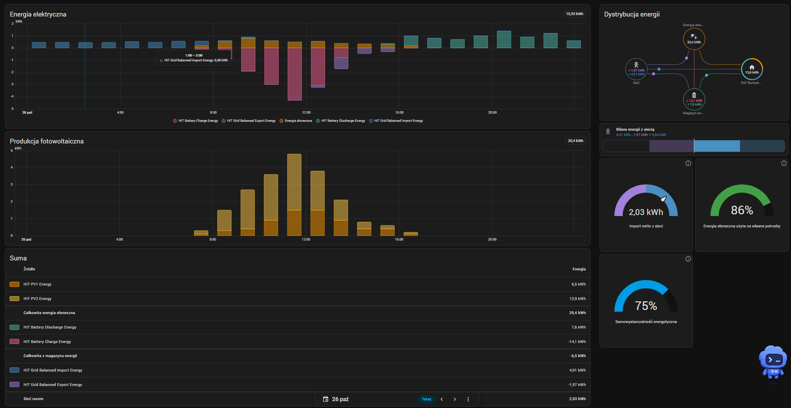

# Hoymiles HIT-G3 for Home Assistant

[](https://github.com/sirartii/ha-hoymiles-hit-g3/actions/workflows/validate.yml)
[](https://github.com/sirartii/ha-hoymiles-hit-g3/releases)
[](https://www.hacs.xyz/docs/faq/custom_repositories/)
[](LICENSE)

Local monitoring of Hoymiles **HIT-(5–20)L-G3** hybrid inverters through a **Modbus TCP to RS485 gateway**. Configure it in the Home Assistant UI. No cloud account is required for monitoring.

The register selection is based on a working **HIT-10L-G3** installation and direct read-only checks. Other HIT-L-G3 power classes are candidates for compatibility, **not individually hardware-tested**. HIT-G3S, HIS, HYS, microinverters and arbitrary Wi-Fi sticks are not covered by this release.

## What you get

- Up to four PV inputs: voltage, current, power, total power and energy.
- G3 battery voltage, **32-bit current and power**, state of charge, capacity and BMS connection status.
- Inverter and EPS measurements for each phase, with correctly calculated power totals.
- Grid power with phase balancing, separate import/export power and meter connection status.
- Lifetime and daily energy counters, with Home Assistant statistics metadata.
- Operating state, temperatures, fault-code diagnostics and redacted support diagnostics.
- Automatic recovery after a lost connection; unavailable readings remain unavailable.

The integration only reads input registers (**FC04**). It does not change inverter, battery, grid or protection settings.

## Example implementation



The reference HIT-10L-G3 installation shows daily energy history, per-input solar production, battery charging and discharging, grid import and export, and energy distribution. This screenshot comes from the original YAML-based configuration used to develop this integration; its interface labels and entity names reflect that installation.

To build a similar view with this integration, follow the [Energy dashboard setup](#energy-dashboard). For the two solar series shown, select **PV1 energy** and **PV2 energy** as separate solar sources instead of also adding the combined **PV energy** sensor. The screenshot's balanced grid energy sensors use Integral helpers fed by phase-balanced import and export power, as described below.

## Connect the converter

```text
Home Assistant ── LAN / Modbus TCP ── Gateway ── RS485 A/B ── HIT-G3
```

1. Use a gateway with **Modbus TCP server to Modbus RTU master conversion**. A transparent TCP serial server without protocol conversion is not supported.
2. Have an installer connect the gateway to the inverter's external Modbus RS485 interface. On the documented HIT-L-G3 **Parallel / PARA2** connector, **pin 8 is 485A** and **pin 7 is 485B**. Connect these to the gateway's corresponding A and B terminals. **Verify the connector and pin numbering in the manual for your exact revision before wiring.** The RJ45-shaped communication socket is not an Ethernet port. Do not use the Meter or BMS bus for polling.
3. Set the gateway's RS485 side to **115200 baud, 8 data bits, no parity, 1 stop bit**, RTU. These are the settings verified on the reference installation; they must match the actual inverter settings. Use **unit ID 1** unless the inverter has been assigned another address.
4. Give the gateway a fixed LAN address or DHCP reservation. Enable its Modbus TCP server, normally on **port 502**, and preserve or map the requested unit ID to the inverter address.
5. Stop other third-party Modbus pollers on the same RS485 bus before connecting this integration. Keep the gateway on the local network.

See the [wiring guide](docs/CONNECTION.md) for the pin table, cable notes and troubleshooting. Electrical work must follow the inverter's isolation procedure and be performed by a qualified installer.

## Install with HACS

Requires **Home Assistant 2026.10 or newer** and HACS.

[](https://my.home-assistant.io/redirect/hacs_repository/?owner=sirartii&repository=ha-hoymiles-hit-g3&category=integration)

Or add it manually:

1. Open **HACS → ⋮ → Custom repositories**.
2. Add `https://github.com/sirartii/ha-hoymiles-hit-g3` with type **Integration**.
3. Download **Hoymiles HIT-G3**, then restart Home Assistant.
4. Open **Settings → Devices & services → Add integration → Hoymiles HIT-G3**.
5. Enter the gateway address, TCP port and inverter unit ID. Select the installed battery, grid meter and PV inputs. The default polling interval is 15 seconds.

For example, a gateway could be `192.0.2.10:502`, unit ID `1`. Replace the example address with your gateway's address. RS485 baud rate is configured on the gateway, not in Home Assistant.

This is a public **HACS custom repository**. It is not currently included in the default HACS catalogue and is not an official Hoymiles integration.

### Manual installation

Copy `custom_components/hoymiles_hit_g3` into `/config/custom_components/`, restart Home Assistant, and add the integration in Devices & services. All runtime files live inside that directory.

## Energy dashboard

In **Settings → Dashboards → Energy**, select the device's sensors:

| Energy dashboard field | Sensor |
| --- | --- |
| Solar production | PV energy |
| Grid consumption | Grid import energy |
| Return to grid | Grid export energy |
| Energy going into the battery | Battery charge energy |
| Energy coming out of the battery | Battery discharge energy |

The energy sensors above are **inverter lifetime counters in kWh**. Statistics are collected from the moment Home Assistant starts recording the new entities. Existing YAML history is not automatically migrated.

Grid **power** is balanced across all phases before splitting import and export. The inverter's grid **energy counters** are exposed as reported; their phase-accounting rules depend on firmware. If you need energy integrated from balanced power, create Integral helpers from **Grid import power** and **Grid export power**, use time unit `h` and metric prefix `k`, and use those helper sensors in Energy instead. Do not add both counter sources to the same energy flow.

## Configuration and updates

Use **Configure** to change the polling interval (5–300 seconds) and response timeout (1–15 seconds). Use **Reconfigure** to change the gateway, unit ID, PV input count or installed hardware. Reconfiguration keeps existing entity identities.

| Measurement | Sign convention |
| --- | --- |
| Battery power and current | Positive = discharge, negative = charge |
| Grid phase power | Raw meter sign; reference installation: positive = export |
| Grid net power | Positive = import, negative = export |
| Grid import/export power | Separate, non-negative values after balancing phases |

If the meter polarity differs, select the matching **Raw meter power direction** during setup or reconfiguration. Confirm it against a known import/export situation.

## Known behavior

- Total-power registers `26`, `45`, `73`, `77`, `87` and `91` can return the fixed placeholder `5`. This integration calculates PV, inverter and EPS active-power totals from their components and reads battery power at `50–51`.
- Battery current uses signed 32-bit registers `48–49`. Reading only register `49` can overflow at higher currents.
- Grid frequency is read from `66`, not `65`. Energy counters are unsigned 32-bit values, scaled by 0.1 kWh.
- Missing optional blocks only make their own readings unavailable. A failed core read makes the device unavailable until a successful poll. Offline BMS or meter status also makes the corresponding live readings unavailable, while lifetime counters can remain available.
- The disabled-by-default **Reported load power** sensor is read from `2169`. It may include inverter losses; it is not a guaranteed billing meter or an EPS-only measurement.
- Only known, bounded address ranges are polled. The integration does not scan unsupported gaps or expose inverter controls.

See the [register reference](docs/REGISTERS.md).

## Moving from YAML Modbus sensors

Back up your existing configuration. Disable the old inverter Modbus hub before enabling this integration, then update dashboards and automations to use the new entities. Keep your old recorded statistics if you need historical data; removing the YAML configuration does not transfer that history to new entity IDs. Disable old integration-based grid energy helpers if you replace them with new ones.

No changes to an existing Home Assistant installation are made by publishing or downloading this repository.

## Troubleshooting

- **No reply:** check protocol-conversion mode, matching RS485 settings, A/B polarity, the correct inverter port, TCP port and unit ID. Stop competing pollers.
- **Only some sensors unavailable:** check BMS/meter connection sensors. The firmware may reject an optional address block. Download diagnostics from the integration menu to see rejected blocks.
- **A power total is unavailable:** one of its required components is missing or outside plausible limits. Missing values are not replaced with zero.
- **Unexpected grid direction:** check meter CT orientation and the raw meter direction setting.
- **Not in Add integration:** check the folder path, restart Home Assistant and refresh the browser.

Open an [issue](https://github.com/sirartii/ha-hoymiles-hit-g3/issues) with your inverter model, firmware, gateway model and redacted diagnostics. Diagnostics contain electrical readings; review them before posting.

To remove the integration, delete its device entry in Devices & services, then remove the repository download from HACS and restart Home Assistant.

## Development

Use Linux with Python 3.14. The pinned Home Assistant test package targets 2026.10.4.

```sh
python -m venv .venv
. .venv/bin/activate
pip install -r requirements-dev.txt
ruff check .
ruff format --check .
pytest -q
```

Tests cover G3 decoding, signed values, unsigned counters, placeholder avoidance, phase balancing, missing data, real Modbus TCP framing against a local simulator, Home Assistant setup, recovery, configuration flows, options, reconfiguration and unloading. GitHub Actions also runs hassfest and HACS validation.

## References

- Working HIT-10L-G3 Home Assistant package and read-only register checks, October–November 2026. Private installation files and network addresses are not distributed.
- [Hoymiles download centre](https://www.hoymiles.com/download/) — use the HIT-L-G3 user manual matching your hardware revision, COM1 connection section.
- [V2C's Hoymiles RS485 connection guide](https://v2charge.com/support/power-control/dynamic/photovoltaic/inverter-hoymiles/) — external RS485 pins and factory settings. Its **9600 baud requirement is specific to Trydan**, not this integration.
- [Original V1.5 community register map](https://github.com/isjo-org/ha-hoymiles-modbus/blob/main/custom_components/hot_hoymiles_modbus/registers.py) — useful background, with the G3 differences documented above.
- [Home Assistant integration documentation](https://developers.home-assistant.io/docs/creating_integration_file_structure/) and [HACS integration requirements](https://www.hacs.xyz/docs/publish/integration/).

MIT licensed. This is a community project, independent of Hoymiles. The included icon is original project artwork, not the manufacturer's logo.
